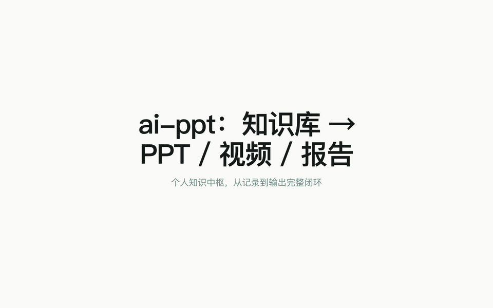

# ai-ppt

[](https://github.com/DrDragonIsMe/ai-ppt)
[](LICENSE)
[](https://nodejs.org)
[](tests)
[](https://drdragonisme.github.io/ai-ppt/)

[中文](README.md) | **English** | **[Live demo](https://drdragonisme.github.io/ai-ppt/)** (requires GitHub Pages, see below)



A personal knowledge hub: a closed loop of **quick-note fragments → AI organization & weighted knowledge graph → PPT / illustrations / video output → smart quizzes for iteration**. Built on a lightweight HTML/CSS/JS slide engine (keyboard navigation, fullscreen presentation, multi-page overview, PDF export) plus a built-in knowledge vault (bidirectional-linked notes, quick-note fragments, knowledge cards, quizzes, mistake collections). It can generate a complete deck from a URL, an article, notes, or a graph selection, and can also generate illustrations and videos with AI. Ships with skill extensions for Claude CLI / Kimi CLI: `/ppt-sources`, `/ppt-marketing`, `/ppt-preview`, `/ppt-structure`, `/ppt-edit`, `/ppt-export`, `/ppt-list`, `/ppt-delete`, `/ppt-design` and more — 13 skills in total (see "Available skills" below).

## Concept model

The system consists of two kinds of entities, connected by "source selection":

- **Knowledge base (personal assets)**: quick-note fragments → AI organization → notes / knowledge cards → weighted graph → quizzes & mistakes for consolidation. Knowledge-base content is independent of any project and accumulates over time.
- **PPT works (projects)**: each project under `projects/` is one deck, with a four-step pipeline lifecycle: **① select sources → ② generate → ③ revise → ④ publish** (export PDF / PPTX / single-file HTML).
- **Source selection**: inside a project workspace, pick notes / cards / fragments / mistakes from the knowledge base as material (persisted to `ai-ppt.json.sourceSelection`), or paste an article / provide a URL directly; the collected material feeds the generation step.

```
Knowledge base (project-independent assets)      PPT works (projects/<name>)
┌───────────────────────────────┐        ┌─────────────────────────────┐
│ fragments → AI organize →     │        │  ① sources → ② generate →   │
│ notes/cards → weighted graph  │ ─pick─▶ │  ③ revise → ④ publish       │
│ → quizzes/mistakes            │        │  (PDF / PPTX / HTML)        │
└───────────────────────────────┘        └─────────────────────────────┘
```

## Repository layout

```
ai-ppt/
├── ai-ppt-base/                  # Reusable PPT engine base (the only upgrade source)
│   ├── index.html                # Sample/default deck
│   ├── css/ppt.css               # Theme & presentation styles
│   ├── js/ppt.js                 # Navigation, fullscreen, overview, PDF export
│   ├── theme-ref/                # Style references
│   └── README.md                 # Deck-level docs
├── templates/                    # Scenario templates (weekly-report / training-course / pitch / review-lesson)
│   ├── weekly-report/
│   ├── training-course/
│   ├── pitch/
│   └── review-lesson/
├── projects/                     # All business decks
│   ├── hualong-xrs-strategy/
│   ├── q3-sales-preview/
│   ├── xinrenxinshi-huaxia-bank/
│   ├── xinrenxinshi-intro/
│   └── ...
├── web/                          # Web management UI
│   ├── index.html
│   ├── css/web.css
│   └── js/modules/               # Build-free ES Modules, entry app.mjs
├── server.mjs                    # Web service entry
├── routes/                       # HTTP routes (sources / marketing / projects / vault / config / media / agent)
├── skills/                       # CLI skills (13, see "Available skills")
├── scripts/                      # Upgrade, generate, export, backup, search, sources, marketing tools
│   ├── sources/                  # Multi-source material library (registry/collect/refresh/store/paths)
│   ├── marketing/                # Marketing outlines & batch generation
│   ├── upgrade-decks.mjs         # Overwrite all projects with base css/js
│   ├── generate-deck.mjs         # Generate a deck from URL/article
│   ├── export-pptx.mjs           # Export PPTX
│   ├── export-pdf.mjs            # Export PDF (optional Puppeteer)
│   ├── backup.mjs                # Project & skill backup
│   └── config.mjs                # Project config read/write
├── tests/                        # node --test (*.test.mjs)
├── install-skills.js             # Node installer
├── install-skills.sh             # Shell installer
├── package.json                  # npx support
├── AGENTS.md                     # Project conventions & memory (Chinese)
├── MEMORY.md                     # Architecture memory
└── README.md                     # Chinese README
```

## Quick start

### 1. Install the skills

```bash
# Option A: Shell
./install-skills.sh

# Option B: Node
node install-skills.js

# Option C: npx (local)
npm link
npx ai-ppt-skills

# Option D: npx (after publish)
npx ai-ppt-skills
```

The installer detects local AI CLIs (`~/.agents`, `~/.kimi-code`, `~/.claude`), reports what was installed where, and prints a quick-start guide at the end. Useful flags: `--dry-run` (print actions only), `--uninstall` (remove installed skills), `--guide` (print the quick-start guide again, also available as `npm run intro`).

Restart your CLI session after installation.

### Live demo (GitHub Pages)

The repo ships a `demo/` directory (product landing page + several single-file HTML demo decks) and `.github/workflows/pages.yml`. After forking or pushing, go to **Settings → Pages → Build and deployment → select GitHub Actions**; every push to `main` then deploys to `https://<username>.github.io/ai-ppt/`.

### LLM configuration (system-level; default: Volcano Ark doubao-seed-2.0-lite)

Model configuration is **system-level**: changes made in the Web UI settings panel apply to all projects and are stored in `.ai-ppt-config.json` (gitignored). Command-line generation reads the same global config.

Priority (highest first):

1. Environment variables `OPENAI_API_KEY` / `OPENAI_BASE_URL` / `OPENAI_MODEL`
2. `modelConfig` in `.ai-ppt-config.json`
3. Built-in default (Volcano Ark doubao-seed-2.0-lite)

```bash
# Option A: Volcano Ark doubao-seed-2.0-lite (default)
export OPENAI_API_KEY=ark-...
export OPENAI_BASE_URL=https://ark.cn-beijing.volces.com/api/coding/v3
export OPENAI_MODEL=doubao-seed-2.0-lite

# Option B: Kimi Code
export OPENAI_API_KEY=sk-kimi-...
export OPENAI_BASE_URL=https://api.kimi.com/coding/v1
export OPENAI_MODEL=kimi-for-coding

# Option C: Bailian CLI
bl login
```

If `OPENAI_API_KEY` starts with `sk-kimi-` and `OPENAI_BASE_URL` is not set, the scripts automatically use `https://api.kimi.com/coding/v1` with the `kimi-for-coding` model.

You can also put these variables into `.env.kimi` (gitignored — do not commit), then start the web service:

```bash
source .env.kimi && npm run web
```

### 2. Create a deck

```bash
/ppt-structure q3-report
```

This generates:

```
projects/q3-report/
├── README.md
├── index.html
├── css/ppt.css
└── js/ppt.js
```

### 3. Edit the deck

```bash
cd q3-report
/ppt-edit slide 1 title "Q3 Business Review"
```

Or edit `index.html` directly.

### 4. Preview

```bash
/ppt-preview              # Preview the deck in the current directory
/ppt-preview q3-report    # Preview projects/q3-report
```

### 5. Upgrade the deck engine

When the styles or interaction engine in `ai-ppt-base` are updated, sync them to all projects:

```bash
npm run upgrade-decks
```

Upgrade a single project:

```bash
npm run upgrade-decks -- --project q3-report
```

See what would change (without copying):

```bash
npm run upgrade-decks -- --dry-run
```

### 6. Web management UI (recommended)

Start the web console to manage projects, configure sources, and generate slides in the browser:

```bash
npm run web
```

Opens `http://localhost:3456` by default. Change port / bind address via `AI_PPT_PORT` / `AI_PPT_HOST` environment variables (`--port` / `--host` CLI flags are not parsed).

- Create/delete projects
- Choose a content source: web URL or pasted article
- Configure title, audience, style, page count, model, and more
- Click "Generate slides" and watch live progress
- Preview opens automatically when generation completes
- **Visual editing**: click "Edit mode" in the preview area to modify text directly on slides; saving writes back to `index.html`
- **AI never overwrites manual edits**: `ai-ppt.json` records `userEdits`, and later AI generation/revision keeps them as constraints
- Press `Ctrl+P` / `Cmd+P` to expand the export dropdown in the project toolbar (PPTX / high-res image PPTX / PDF / single-file HTML)

### 7. Command-line generation & export

Generate slides for a project:

```bash
npm run generate -- q3-report
```

Export PPTX (editable text, approximate layout):

```bash
npm run export-pptx -- q3-report
```

Export high-res image PPTX (per-page screenshots, highest fidelity):

```bash
npm run export-pptx-image -- q3-report
```

Export PDF (auto-detects system Chrome; falls back to browser print instructions if absent):

```bash
npm run export-pdf -- q3-report
```

Artifacts are saved in `projects/<deck-name>/export/`:

```
projects/q3-report/export/
├── deck.pptx        # Editable-text version
├── deck-image.pptx  # High-res image version
└── deck.pdf         # PDF version
```

### 8. Backup

Create a backup before batch changes:

```bash
npm run backup
```

Backups are stored in `.backup/<timestamp>/`.

## Marketing pipeline: source library → outline → batch PPTs

The full workflow for turning multi-source information into a set of angle-specific marketing decks (also available in the Web UI **Sources** tab):

1. **Configure sources**: register a local directory, single page, site entry, or vault notes path as a source.
   ```bash
   # In-repo directory source (text files only by default)
   curl -X POST http://localhost:3456/api/sources \
     -H 'Content-Type: application/json' \
     -d '{"type":"dir","name":"Marketing materials","target":"docs/marketing"}'

   # Single page / site entry
   curl -X POST http://localhost:3456/api/sources \
     -H 'Content-Type: application/json' \
     -d '{"type":"url","name":"Intro page","target":"https://example.com/intro"}'

   curl -X POST http://localhost:3456/api/sources \
     -H 'Content-Type: application/json' \
     -d '{"type":"site","name":"Website","target":"https://example.com","options":{"depth":1}}'
   ```
   - Source types: `dir | url | site | vault`. External directories require `AI_PPT_ALLOW_EXTERNAL_SOURCES=1` **and** `acknowledgeExternalPath:true` in the request.
   - Tunable options: `maxPages` (default 30), `maxBytesPerItem` (default 512KB), `depth` (site only, default 1), `include`, `label`, `anyOfTags`.

2. **Refresh sources**:
   ```bash
   curl -X POST http://localhost:3456/api/sources/<sourceId>/refresh
   # progress: GET /api/sources/<sourceId>/refresh/events
   ```
   Refreshes are incremental using SHA-256 hashes; vanished upstream items are pruned after a successful run; transient failures are kept as `stale` and reported via SSE and `GET /api/sources`.

3. **Generate a marketing outline**:
   ```bash
   node scripts/marketing/generate-outline.mjs \
     --source src-a,src-b \
     --product "Product Name" \
     --audience "Enterprise decision makers" \
     --tone "Professional, restrained, evidence-based" \
     --angle-set marketing-standard \
     --slides 5
   ```
   Output: `marketing/outlines/<mo-xxx>.json`. Built-in `marketing-standard` has six angles: pain / capability / scenario / differentiation / ROI / proof. Every `evidenceItemIds` citation must point to a real material item; fabricated references are dropped and counted.

   > **Verify the LLM link is up**: if the outline `done` event shows `llmShortCircuited:true`, the first angle's LLM call failed and the rest were skipped. Open the top-bar **Settings** panel and check Base URL, Model, and API Key, then switch to an active model (e.g. under Volcano Ark `https://ark.cn-beijing.volces.com/api/v3`: `doubao-seed-2-1-pro-260915` or `deepseek-v4-flash-ga-260731`).

4. **Batch-generate decks**:
   ```bash
   node scripts/marketing/batch-generate.mjs <outlineId> \
     --angles pain,capability \
     --slides 8 \
     --theme web-ui \
     --animation slide
   ```
   Output: `projects/mkt-<angleKey>-slug/` — one independent deck per angle, with `ai-ppt.json.sourceSelection.kind = 'outline'` binding the outline and angle. Only one outline generation and one batch run are allowed globally at a time (409 on duplicate), and batches can be cancelled via `POST /api/marketing/batch/cancel`.

5. **Export / publish**: for each generated deck use `/ppt-export <deckName> pdf|pptx` or `/ppt-publish publish <deckName>`.

> **Artifact policy**: `sources.json`, `vault/.meta/source-cache/`, `marketing/`, `projects/<name>/export/`, `cover.png`, `references/`, and all video files (`*.mp4/mov/webm`) are excluded from git; `demo/` and `web/icons/` are intentionally kept for GitHub Pages / PWA.

## Keyboard shortcuts

### Presentation page

| Key | Action |
|------|------|
| `→` / `←` | Next / previous slide |
| `Cmd + →` / `Cmd + ←` | Last / first slide |
| `↑` | Multi-page overview |
| `↓` | Export PDF |
| `Ctrl + P` / `Cmd + P` | Print / export dropdown (Web UI) |
| `F` | Fullscreen |
| `T` | Cycle themes |
| `s` | Thumbnail sidebar (hidden in fullscreen) |
| `Shift + S` | Speaker mode (notes + next-slide preview + timer) |
| `M` | Marker pen (available in fullscreen; annotations saved per slide) |
| `1`-`5` (marker mode) | Pen / arrow / rectangle / circle / ellipse |
| `C` (marker mode) | Clear annotations on this slide |
| `Esc` (marker mode) | Exit marker mode |
| `?` | Help panel (hidden in fullscreen) |
| `ESC` | Exit |

### Web management UI

| Key | Action |
|------|------|
| `?` | Help panel |
| `Ctrl + N` | New project |
| `Ctrl + S` | Save note / save project config (context-dependent) |
| `Ctrl + P` | Export dropdown |
| `Ctrl + G` | Generate slides |
| `Ctrl + O` | Open preview |
| `Ctrl + K` | Global search |
| `Ctrl + Shift + O` | Quick switcher (jump to note) |
| `Ctrl + Shift + N` | Global quick note |
| `Tab` | Switch config tabs |
| `ESC` | Close modals/panels |

## Available skills

| Skill | Purpose |
|-------|------|
| `/ppt-sources` | Manage the multi-source material library (dir/url/site/vault) |
| `/ppt-marketing` | Generate a marketing outline from sources and batch-produce decks |
| `/ppt-preview [deck]` | Start a local server to preview a deck |
| `/ppt-structure <name>` | Scaffold a new deck from `ai-ppt-base` |
| `/ppt-edit [instruction]` | Edit slide text and layout |
| `/ppt-export [deck] [pdf\|pptx]` | Export PDF or PPTX |
| `/ppt-list` | List all decks |
| `/ppt-delete <deck>` | Delete a deck (asks for confirmation) |
| `/ppt-design` | Slide design guidelines (followed when generating/editing/reviewing) |
| `/ppt-anim` | Configure animation effects |
| `/ppt-data` | Data-visualization components |
| `/ppt-theme` | Manage and switch themes |
| `/ppt-publish` | Publish decks and manage release versions |

## Knowledge-hub workflow

The full loop from quick notes to review happens in the Web UI (`npm run web`):

1. **Quick notes**: press `Ctrl+Shift+N` anytime to capture a fragment into the `vault/fragments/` inbox; `#tags` in the body are extracted automatically.
2. **AI organization**: click "AI organize" in the fragments panel to get per-fragment suggestions (promote to card/note/mistake, add tags, link notes, merge, or skip), then confirm one by one; without a model, suggestions fall back to deterministic rules.
3. **Knowledge graph**: graph nodes carry `weight` (link degree + mention count) and `reviews` (review count); a "high-frequency only" filter focuses on core knowledge, and selected nodes can be turned into a PPT in one click.
4. **Smart quizzes / review PPTs**: generate quizzes from a pool of low-mastery cards, due-review cards, and historical mistakes (LLM variant questions, deterministic fallback without a model); cards/mistake collections can be turned into review decks with AI-generated illustrations.

## Publishing to npm

To let others install via npx:

```bash
npm publish --access public
```

Then anyone can run:

```bash
npx ai-ppt-skills
```

## Available decks (projects directory)

| Deck | Description |
|------|------|
| `ai-ppt-base/` | Reusable PPT engine base template |
| `projects/hualong-xrs-strategy/` | Hualong District × Xinrenxinshi: industry analysis & digital-labor cooperation |
| `projects/q3-sales-preview/` | Q3 sales-team mobilization |
| `projects/xinrenxinshi-huaxia-bank/` | Xinrenxinshi × Hua Xia Bank |
| `projects/xinrenxinshi-intro/` | Xinrenxinshi product introduction |

## Changelog

### v2.9.0 — Source library → marketing outline → batch PPTs (2026-11)

- **Multi-source material library**: `dir` / `url` / `site` / `vault` source types; `sources.json` registry + `vault/.meta/source-cache/` cache; incremental refresh via SHA-256 hash; observable `maxPages` truncation and stale preservation on partial failures.
- **Marketing outlines**: built-in `marketing-standard` six-angle set; per-angle LLM output in a strict contract shape, deterministic fallback when no LLM; anti-fabrication validation drops references to non-existent item IDs.
- **Batch generation**: serial per-angle deck generation, `ai-ppt.json.sourceSelection.kind='outline'` binding; global single-batch 409 deduplication, cancellation, auto design-lint and cover capture.
- **Artifact policy**: `export/`, `cover.png`, `marketing/`, `vault/.meta/source-cache/`, `references/`, and video files are excluded from git; `demo/` and `web/icons/` are intentionally kept for GitHub Pages / PWA.
- **Docs**: AGENTS.md adds source/marketing/artifact conventions; READMEs add the new workflow chapter; test entry unified to `node --test tests/*.test.mjs` (335 pass / 101 suites).

### v2.6.0 — Usability fixes & information-architecture consolidation (2026-07)

- **Note saving**: `Ctrl+S` dispatched by context (save note / save project config), 2s debounced autosave, dirty marker (●), beforeunload protection, localStorage draft recovery.
- **Unified modals**: new `modals.mjs` (`showInputModal`/`showConfirmModal`); all native prompt/confirm calls removed.
- **Single "Generate PPT" entry**: `generate.mjs` `#gen-modal` + `openGenerateModal(source)` unifies the four sources (note / multi-select / graph / review).
- **Single export entry**: project-toolbar `#export-dropdown` (PPTX / high-res image PPTX / browser-print PDF / single-file HTML), expanded with `Ctrl+P`.
- **Sidebar "Study" tab**: quizzes / mistakes / review training merged; settings entry consolidated into the top-bar gear.
- **Under the hood**: search index now rebuilt per project automatically; project snapshots kept at 20, vault backups at 200 with auto-prune; dead code removed (`web.js`, `build-fonts`, etc.).

### v2.3.2 — AI revision results show change details (2026-07)

- After an AI conversational revision of a note/PPT completes, the result bubble shows **change details** in addition to "done": the LLM's itemized change list first (new `---修改说明---` output convention in the prompt), falling back to a line-level diff (`-` removed / `+` added, LCS-based, capped at 40 lines).
- Details are delivered via the SSE `done.details` event and persisted in the PPT chat history (`chat-history.json`), so they survive page reloads.

### v2.3.1 — Model key persistence & system-level settings entry (2026-07)

- **Optional API key persistence**: each of the three model groups in the settings panel can opt into "save to local config" (`.ai-ppt-config.json`, gitignored); key resolution priority is env var > config file, and `GET /api/config` only returns an `apiKeySet` mask, never plaintext. One opt-in stops repeated "LLM not configured" errors in AI chat/generation.
- **System-level gear entry**: a ⚙ button in the top bar opens system settings anytime (the sidebar "Settings" tab remains).
- **Error guidance**: when chat/generation/AI features hit "no usable LLM configured", the error automatically appends a pointer to the settings panel.

### v2.3.0 — System settings area & stronger AI chat (2026-07)

- **Dedicated "Settings" area**: the three model configs (text / image / video) moved from the project "Sources" tab to a system-level settings panel applying to all projects (reusing `GET/POST /api/config` and the `POST /api/media/test` probe; API keys are not written to disk); the panel includes a one-click data-backup entry (`POST /api/backup`).
- **Note AI chat revision**: the note editor gains "AI revise" — natural-language instructions rewrite the note; `POST /api/vault/notes/:name/chat` returns 202 immediately and `GET .../chat/events` streams progress over SSE. The underlying `scripts/chat-note.mjs` (NDJSON protocol) auto-backs-up the note to `.snapshots/_vault/` before editing, requires the LLM to preserve Front Matter and `[[wikilink]]`s, and leaves the file untouched on failure.
- **PPT AI chat history persistence**: "AI revise" chat logs are written to `projects/<name>/chat-history.json` (max 50 entries) and reloaded via `GET /api/projects/:name/chat/history`, so history survives refreshes.

> Full history (v1.2 → v2.7.0) in [CHANGELOG.md](CHANGELOG.md) (Chinese).

## Documentation

- [CHANGELOG.md](CHANGELOG.md) — version history (Chinese)
- [AGENTS.md](AGENTS.md) — project conventions & architecture notes (Chinese)
- [CONTRIBUTING.md](CONTRIBUTING.md) — development setup & contribution guide (Chinese)
- [ai-ppt-base/README.md](ai-ppt-base/README.md) — deck-level engine docs

## License

MIT — see [LICENSE](LICENSE).
